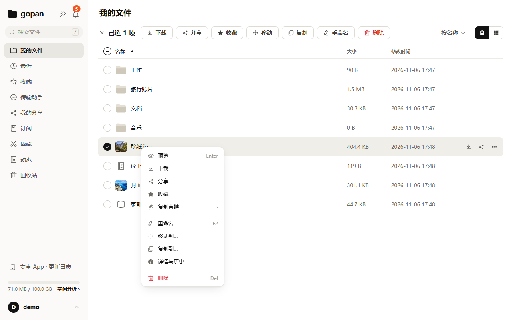
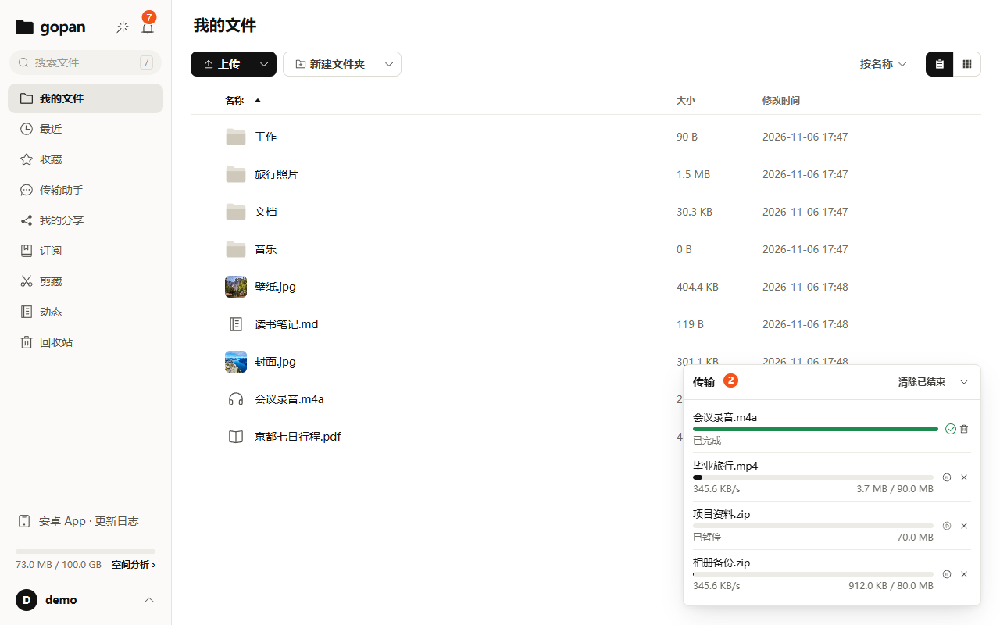
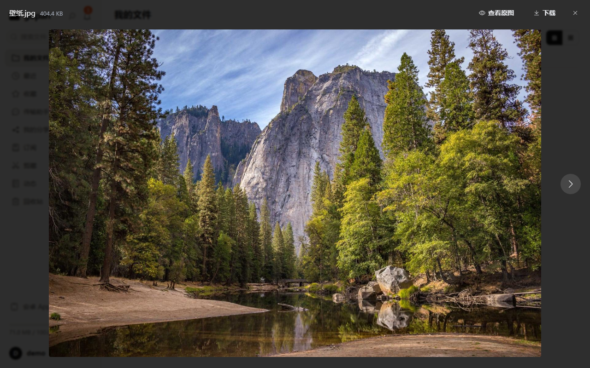
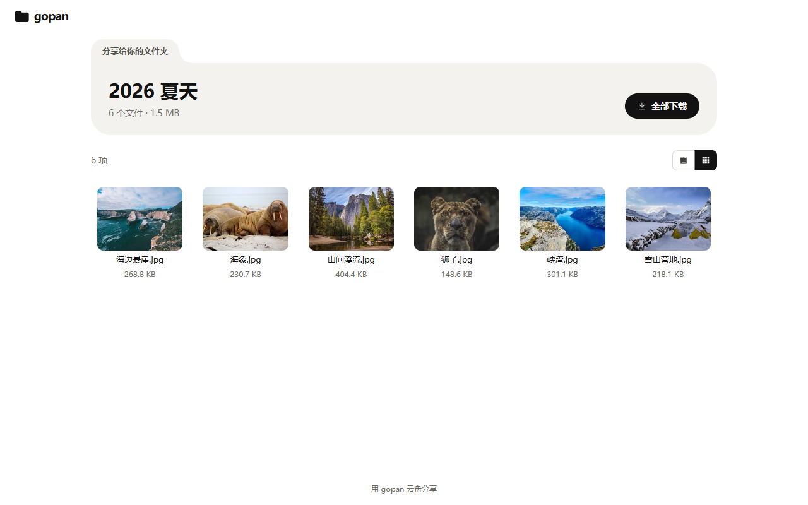

# gopan

[简体中文](README.md) · **English**

A self-hosted cloud drive. Go + GraphQL + Postgres + MinIO backend shipped as a single binary; it runs comfortably on a 2-core / 2 GB VPS. Three clients: a Vue 3 web app, a native Android app (Kotlin + Jetpack Compose) and a Windows desktop app (Tauri).

- **Built-in AI assistant** in the web, desktop and Android apps: finds files, reads documents, organizes folders and creates shares. Changes ask for confirmation first, and a whole run can be handed to the server so it finishes even after you close the client.
- **Remote MCP server included**: Claude, ChatGPT, Codex and other agents connect over OAuth 2.1 and can search, read, organize and share your files within the scopes you grant. File bytes never pass through MCP, and every change an agent makes can be undone by source from the activity log. Client setup: [docs/MCP.md · 客户端接入](./docs/MCP.md#客户端接入); usage guide for agents: [Agent Skill](./skills/gopan/).


**Live instance**: <https://drive.979687.xyz> (a 2-core / 2 GB VPS, lean profile)

| | |
|---|---|
|  |  |
|  |  |

> The design documents under [doc/](./doc/) and most code comments are written in Chinese. This page is the English entry point; release notes are in [CHANGELOG.md](./CHANGELOG.md) (Chinese).

## Features

- **Transfer**: browser uploads go straight to object storage in 16 MB parts; resumable uploads, instant uploads for content the server already has (content-addressed by SHA-256), pause / resume / retry.
- **Files**: folders, move / copy / rename (also in bulk), natural sort order, favorites, recents, version history on overwrite, editing text files in place, a 30-day trash.
- **Search**: by name, and by the text inside PDF, Word / Excel / PowerPoint, OpenDocument and plain-text files (works for Chinese too).
- **Preview and media**: images, video and audio streaming, PDF, text and code, Markdown, optional Office-to-PDF; subtitles, resume playback across devices, playlists by folder.
- **Sharing**: share links with password and expiry, shared folders the recipient can upload into, file-request links for people without an account, permanent direct links and an image-hosting API with traffic caps.
- **Background jobs**: offline downloads (the server fetches a URL for you, private networks blocked), archive browsing and extraction (zip / 7z / rar / tar), RSS / podcast / GitHub Releases subscriptions, saving web pages as Markdown.
- **Activity and undo**: every change records where it came from (web, app, WebDAV, agent, background job) and can be undone individually, in batches or by source.
- **Also**: WebDAV, push notifications (ntfy / Bark / Telegram / webhook), an admin console, Prometheus metrics, daily backups with an off-site copy.

What it deliberately does not do (collaborative editing, end-to-end encryption, video transcoding, clustering, iOS app …) is listed in [doc/12](./doc/12-产品说明.md).

## Architecture in one paragraph

**On the main transfer paths, file bytes do not pass through Go**: the browser, the Android app and agents all upload and download with presigned URLs directly against MinIO. The explicit exceptions (streaming zip, WebDAV, offline downloads, archive extraction, direct links that need traffic accounting) are rate-limited. Files are content-addressed, so identical content is stored once while quotas are counted per user. Types are generated end to end: sqlc (SQL → Go), gqlgen (schema → resolvers) and GraphQL Code Generator (schema → TypeScript). See the diagram in the [Chinese README](./README.md#架构).

## Quick start

### Deploy with the prebuilt image

You need a Linux host with a public IP (2 GB RAM is enough), a domain pointing at it, and Docker with the compose plugin. The image is built by GitHub Actions, so nothing is compiled on the server (linux/amd64 only):

```bash
git clone https://github.com/yophon/gopan.git /opt/gopan && cd /opt/gopan
cp .env.example .env && vi .env    # domain, two passwords, deployment profile; uncomment GOPAN_IMAGE
mkdir -p secrets && openssl rand -base64 48 > secrets/jwt_secret
chown 10001:10001 secrets/jwt_secret && chmod 400 secrets/jwt_secret && chmod 600 .env
docker compose -f docker-compose.prod.yml pull
docker compose -f docker-compose.prod.yml up -d --no-build
```

Choosing between the bundled Caddy (automatic certificates) and a host nginx, reverse-proxy rules, upgrades, backup and restore, and troubleshooting are covered in [doc/09](./doc/09-上线手册.md) (Chinese).

### Develop

```bash
make dev-env      # postgres / minio / gotenberg via compose
make dev-server   # backend on :8080 (runs migrations)
make dev-web      # frontend on :5173 (proxies to :8080)

make gen          # regenerate code after editing schema.graphqls or db/queries
make test         # go test + vet (integration tests need TEST_DB_URL)
make build        # build the frontend and embed it into server/gopan
```

In production the binary needs only `GOPAN_DB_URL` and `GOPAN_JWT_SECRET` (at least 32 bytes); all options are listed in doc/09.

The Android and desktop apps have their server address baked in at build time: create `client.env` at the repository root from `client.env.example` (see doc/18).

## Connecting agents

- Endpoint: `https://<your-domain>/mcp` (Streamable HTTP). OAuth 2.1 with dynamic client registration and PKCE, or an API key for headless use.
- 40+ tools: listing, search, content search, reading text and documents, folders, move / copy / rename / trash, uploads and downloads through presigned URLs, shares, file requests, direct links, offline downloads, archives, web clipping, the activity log.
- Full reference: [docs/MCP.md](./docs/MCP.md) (Chinese).

## License

[MIT](./LICENSE). `web/src/vendor/tau/` is compiled output of [tau](https://github.com/yophon/tau), also MIT.
