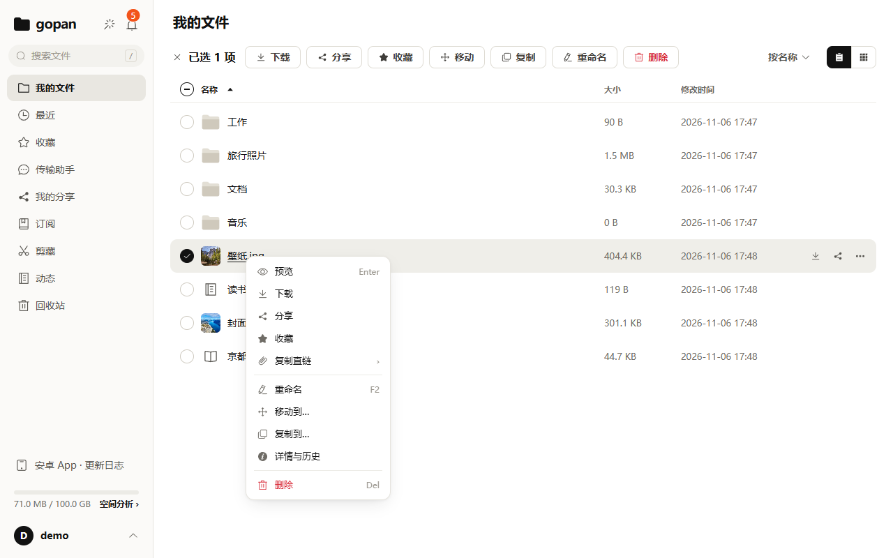
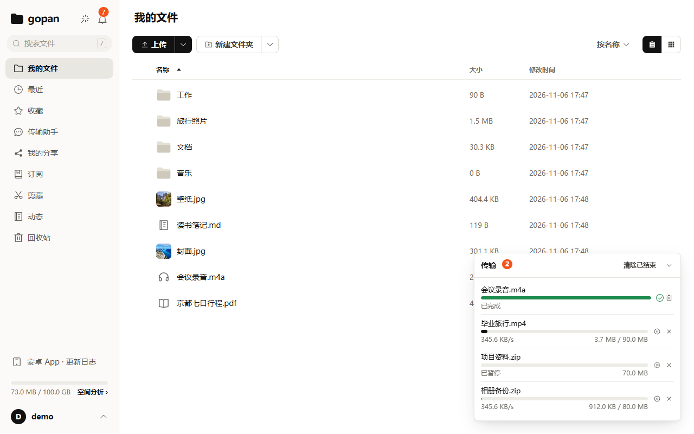
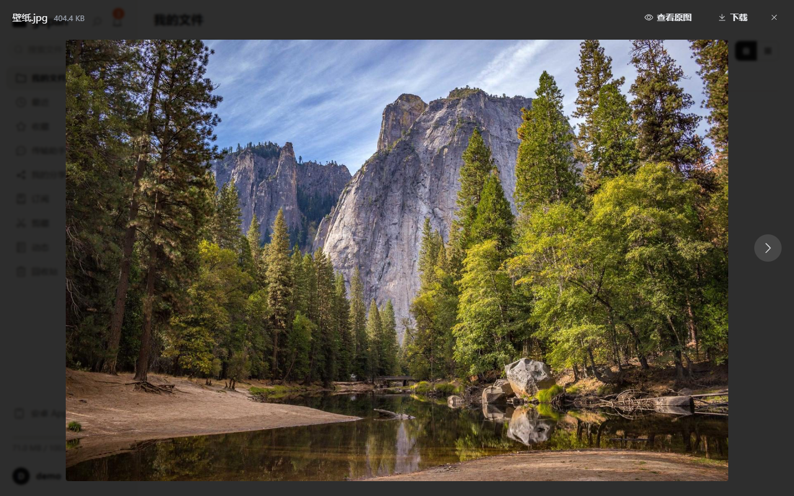
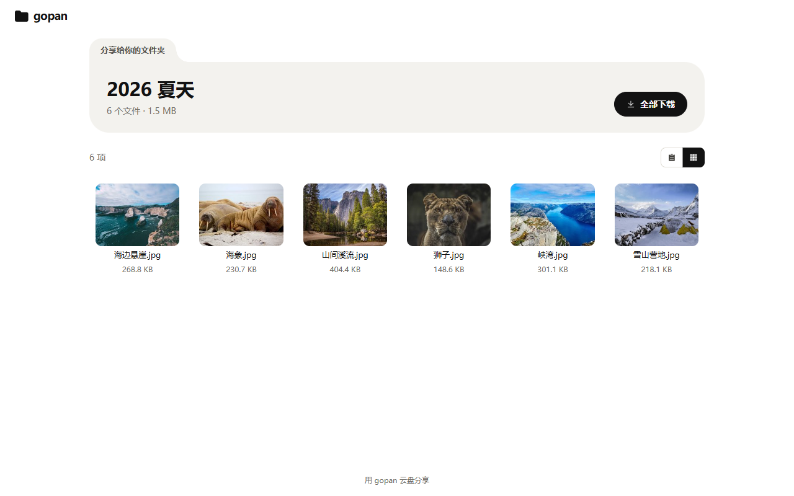
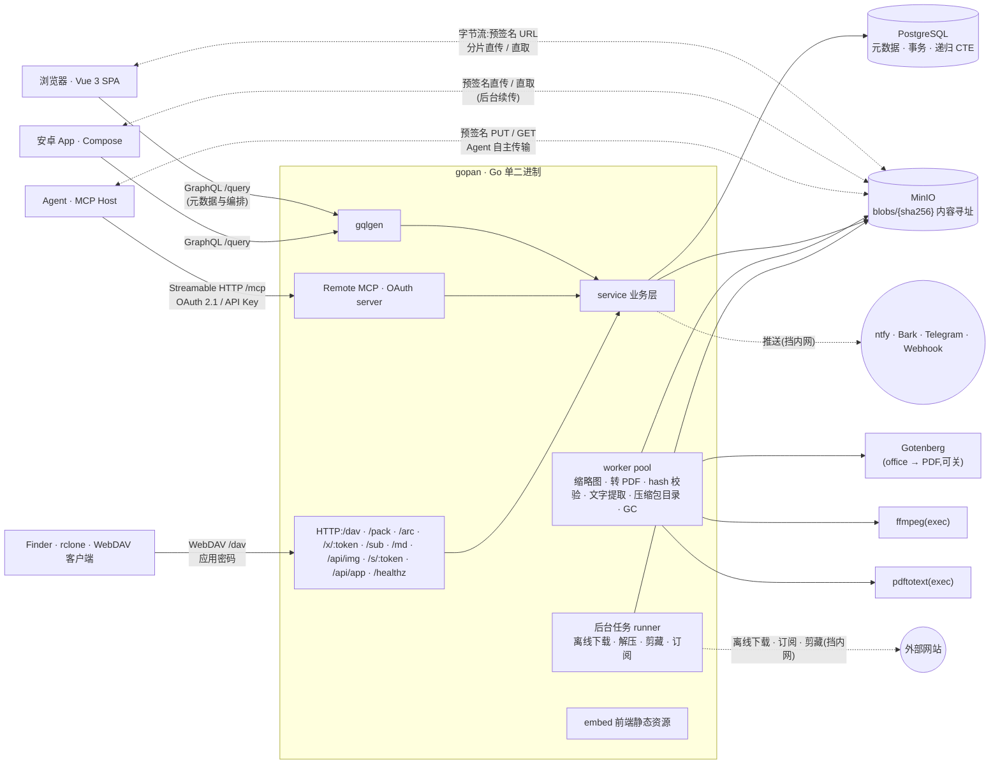

# gopan

**简体中文** · [English](README.en.md)

自部署云盘。Go + GraphQL + Postgres + MinIO 后端,单二进制交付,2 核 2G 的 VPS 就能跑。三个客户端:Vue 3 网页、Kotlin + Jetpack Compose 的安卓原生 App、Windows 桌面端(Tauri)。

- **内置 AI 助手**:网页、桌面端、安卓 App 里都能用,找文件、读文档、整理、建分享;改动先确认,也能整轮交给服务器跑。
- **自带 Remote MCP**:Claude、ChatGPT、Codex 等 Agent 经 OAuth 2.1 接入,在你授权的范围里找、读、整理、分享网盘里的文件;文件字节不经过 MCP,Agent 做的每次改动都能在「动态」里按来源撤回。各客户端怎么接见 [docs/MCP.md · 客户端接入](./docs/MCP.md#客户端接入),给 Agent 的用法说明见 [Agent Skill](./skills/gopan/)。


**在线实例**:<https://drive.979687.xyz>(跑在 2 核 2G 的 VPS 上,精简档部署)

<!--
截图待补。拍好放 doc/assets/ 后取消下面的注释即可(浏览器窗口 1280 宽,浅色主题):
1. drive.png   — 主目录页:混合类型文件(图片有缩略图)、右键菜单打开
2. upload.png  — 上传抽屉:3 个以上任务,含进行中(有速度)/暂停/完成三种状态
3. preview.png — 图片或视频预览模态
4. share.png   — 分享访客页(输密码那屏或文件列表屏)

| | |
|---|---|
|  |  |
|  |  |
-->

当前版本与每一版改了什么见 [CHANGELOG](./CHANGELOG.md)(站点的 `/app` 页面与 App 的「更新日志」展示的就是它);功能全貌见 [12 · 产品说明](./doc/12-产品说明.md)。

## 架构



要点:**主传输路径字节流不过 Go**——浏览器、安卓 App 和 Agent 都拿预签名 URL 直传/直取 MinIO。显式例外只有流式 zip(`/pack`、`/mcp-download`)、协议决定必须中转的 WebDAV PUT/GET、几 MB 的安卓安装包(`/api/app/android/`),v3.3 的离线下载(服务器替你从源站拉)与压缩包(解压、`/arc` 预览包里的单个文件),以及 v3.4 的直链(`/x/`,经 Go 才能记流量、按上限拦、吊销即时生效)、图床上传与字幕转换,都有并发闸。文件按 SHA-256 内容寻址,全站同内容物理只存一份(秒传),配额按逻辑大小各记各的。类型从数据库到组件不断链:sqlc(SQL→Go)、gqlgen(schema→resolver)、GraphQL Code Generator(schema→TS),改一处两端编译报错。

## 快速开始

### 部署(用预构建镜像)

一台有公网 IP 的 Linux 主机(2G 内存够用)、一个解析到它的域名、Docker 与 compose 插件。镜像由 GitHub Actions 构建,机器上不编译(只有 linux/amd64):

```bash
git clone https://github.com/yophon/gopan.git /opt/gopan && cd /opt/gopan
cp .env.example .env && vi .env    # 填域名与两个密码,选部署档位,取消 GOPAN_IMAGE 的注释
mkdir -p secrets && openssl rand -base64 48 > secrets/jwt_secret
chown 10001:10001 secrets/jwt_secret && chmod 400 secrets/jwt_secret && chmod 600 .env
docker compose -f docker-compose.prod.yml pull
docker compose -f docker-compose.prod.yml up -d --no-build
```

选档(自带 Caddy 自动证书,还是交给宿主 nginx)、反代约定、升级、备份与恢复、排障都在 [09 · 上线手册](./doc/09-上线手册.md)。

### 开发

```bash
make dev-env      # compose 起 postgres/minio/gotenberg
make dev-server   # 后端 :8080(自动跑迁移)
make dev-web      # 前端 :5173(proxy → 8080)

make gen          # 改了 schema.graphqls / db/queries 后重新生成三件套
make test         # go test + vet(集成测试需 TEST_DB_URL)
make build        # 前端构建 + embed → server/gopan 单二进制
```

生产运行只需要 `server/gopan` 二进制 + `GOPAN_DB_URL` + `GOPAN_JWT_SECRET`(≥32 字节),配置项见 doc/08。

安卓 App 与桌面端连哪个站点是打包时定的:照 `client.env.example` 在仓库根建 `client.env`(不进 git)写上自己实例的地址,两端都读它(doc/18「自部署」)。

## 设计文档

浏览器上传的 staging 隔离、配额复核、失败恢复和升级兼容说明见 [15 · 上传一致性修复](./doc/15-浏览器上传一致性修复.md)。

Agent 接入与远程 MCP 工具见 [docs/MCP.md](./docs/MCP.md)(各客户端的接法在[客户端接入](./docs/MCP.md#客户端接入)一节),给 Agent 的用法说明见 [skills/gopan/](./skills/gopan/)。

全部设计文档在 [doc/](./doc/):

| 文档 | 内容 |
|---|---|
| [01 · 需求与范围](./doc/01-需求与范围.md) | v1 功能清单、明确不做的、非功能要求、术语表 |
| [02 · 技术选型](./doc/02-技术选型.md) | 前后端选型表、不用什么及理由 |
| [03 · 架构与核心流程](./doc/03-架构与核心流程.md) | 组件图;浏览器/Agent 传输、下载、预览、分享、GC 流程 |
| [04 · 数据模型](./doc/04-数据模型.md) | Postgres 核心结构、凭据/传输表、不变量、容量估算 |
| [05 · GraphQL 设计](./doc/05-GraphQL设计.md) | SDL 约定、Agent 凭据控制面、resolver 要点 |
| [06 · 认证与安全](./doc/06-认证与安全.md) | 登录双 token、访客、WebDAV、MCP OAuth/API Key、预签名边界 |
| [07 · 前端设计](./doc/07-前端设计.md) | 路由/组件/store 划分、上传器状态机、token 处理层 |
| [08 · 项目结构与部署](./doc/08-项目结构与部署.md) | 仓库布局、开发流、compose、运维、里程碑 |
| [09 · 上线手册](./doc/09-上线手册.md) | 从裸机到可用:部署/升级/回滚/备份恢复/排障/配置速查 |
| [10 · 真机部署复盘](./doc/10-真机部署复盘.md) | 首次真机部署踩的坑与教训、新机检查清单 |
| [11 · 使用手册](./doc/11-使用手册.md) | 面向使用者:上传/预览/分享/回收站怎么用、常见问题 |
| [12 · 产品说明](./doc/12-产品说明.md) | 定位、功能总览、能力边界、数据与安全、同类对比 |
| [13 · v2 规划](./doc/13-v2规划.md) | M7 管理端 → M8 规模(keyset/子树统计)→ M9 WebDAV,原则与取舍 |
| [14 · 测试补强与已知问题](./doc/14-测试补强与已知问题.md) | 测试惯例与覆盖率现状、已发现未修的潜在问题清单 |
| [15 · 浏览器上传一致性修复](./doc/15-浏览器上传一致性修复.md) | staging 隔离、配额复核、失败恢复、升级兼容 |
| [16 · 备份恢复演练](./doc/16-备份恢复演练.md) | 异地副本恢复的实战记录与字节级判据 |
| [17 · 传输助手改进计划](./doc/17-传输助手改进计划.md) | v2.5 传输助手整改的问题清单与方案 |
| [18 · 安卓 App](./doc/18-安卓App.md) | 原生客户端的功能、安装升级、权限、系统集成、自部署、发布流程 |
| [CHANGELOG](./CHANGELOG.md) | 给用的人看的更新日志,站点发布页 `/app` 与 App「更新日志」展示的就是它 |
| [19 · 安卓原生 App 计划](./doc/19-安卓原生App计划.md) | 网页 → 原生功能对照、技术选型、登录协议、P1–P4 里程碑与验收记录 |
| [20 · 收集文件与内容搜索计划](./doc/20-收集文件与内容搜索计划.md) | 匿名收集链接(访客只写不读)、中文内容搜索(二元切词 + 原生全文索引)、P0 安全前置与里程碑 |
| [21 · 离线下载与压缩包计划](./doc/21-离线下载与压缩包计划.md) | 后台任务底座、离线下载防 SSRF 与断线续传、压缩包目录索引 / 预览 / 解压的上限与里程碑 |
| [22 · 影音、通知与图床计划](./doc/22-影音通知与图床计划.md) | 媒体类型补全、字幕 / 续播 / 连播,通知合并与推送投递,直链中转与审计检测、图床接口与 GPS 抹除 |
| [23 · 动态、空间、订阅与剪藏计划](./doc/23-动态空间订阅剪藏计划.md) | 改动的来源与撤回、大量删除提醒,空间分析与自然顺序,RSS / 播客 / GitHub 订阅,网页剪藏与服务端 Markdown 渲染 |
| [24 · 收藏、最近打开与历史版本](./doc/24-收藏最近与历史版本.md) | 收藏、「最近」(带看到哪)、同名覆盖留历史版本;v3.10.0 |
| [25 · 在线编辑文本](./doc/25-在线编辑文本.md) | 文本文件直接改、App 替换上传;v3.11.0 |
| [26 · 离线可用](./doc/26-离线可用.md) | 安卓 App 把文件存一份在本机,不同步只是副本;v3.12.0 |
| [27 · 批量重命名与分享存到文件夹](./doc/27-批量重命名与分享存到文件夹.md) | 批量重命名、把别人的分享存进自己的文件夹、离线可用补全;v3.13.0 |
| [28 · 备选功能](./doc/28-备选功能.md) | 活的清单:想过还没定的功能,以及明确不做的和原因 |
| [29 · 桌面端计划](./doc/29-桌面端计划.md) | Windows 桌面端:窗口里是网页版,Tauri 2 外壳补托盘传输、文件夹下载、截图上传、右键上传 |
| [30 · 搜索筛选](./doc/30-搜索筛选.md) | 文件名与内容搜索加类型、时间、大小、文件夹范围筛选与排序;v3.15.0 |
| [31 · 影音补强与一步分享](./doc/31-影音补强与一步分享.md) | 网页放 mkv(只换封装)、歌词、用电脑上的播放器放、一步生成分享链接;v3.17.0 |
| [32 · 分享上传与自动刷新](./doc/32-分享上传与自动刷新.md) | 文件夹分享允许对方上传;别处改了网盘,打开着的列表自己刷新;v3.19.0 |
| [33 · 助手](./doc/33-助手.md) | 内置 AI 助手:内核是 tau,用 gopan 自己的 MCP 工具;权限三态、确认卡、站点模型或自己的 key、转发或直连 |
| [34 · 助手在服务器上运行](./doc/34-助手在服务器上运行.md) | 整轮交给服务器跑(每轮一个 qjs 进程),关掉客户端照样跑完,等确认时推送通知 |
| [35 · 助手看图与读写文件](./doc/35-助手看图与读写文件.md) | 看图、对话里发图、写文本文件、回答里引用文件 |
| [36 · 局域网直传计划](./doc/36-局域网直传计划.md) | 桌面端与安卓同一局域网直接互传,字节不经过服务器,兼容 LocalSend v2 协议 |
| [37 · 助手的定时任务、图片识字与入口](./doc/37-助手定时任务、图片识字与入口.md) | 到点由服务器跑的定时任务、用能看图的模型识别图片里的字、从别的 App 带着文件打开助手 |
| [38 · 助手的长期记忆](./doc/38-助手的长期记忆.md) | 每人一份「关于你」,助手自己记、自己改;用 tau 的长期记忆扩展,gopan 只提供存储 |

## 实现回顾

每个里程碑实际交付了什么、关键决策、踩坑记录,在 [doc/milestones/](./doc/milestones/)。v3.5 之后各版本的设计与取舍写在 doc/24 起的各篇文档里(上表),逐版的变化见 [CHANGELOG](./CHANGELOG.md):

| 里程碑 | 内容 |
|---|---|
| [M1 · 骨架](./doc/milestones/M1-骨架.md) | 双 token 认证、目录树 CRUD、三条代码生成链、embed 单二进制 |
| [M2 · 传输](./doc/milestones/M2-传输.md) | 分片直传、秒传、断点续传、hash 校验与谎报回收、自研上传器 |
| [M3 · 预览](./doc/milestones/M3-预览.md) | 派生物管线(缩略图/封面/时长/Office 转 PDF)、预览模态 |
| [M4 · 分享](./doc/milestones/M4-分享.md) | 分享链接、访客子树授权、og 落地页、流式 zip 打包 |
| [M5 · 收尾](./doc/milestones/M5-收尾.md) | 欠账清零(回收站自动清理/复制/搜索/配额/改密码)+ Docker 生产化 |
| [M6 · 加固](./doc/milestones/M6-加固.md) | 测试 64%→73%、/pack 双闸限速、refresh 清理、深度限制、/metrics、安全头、smoke 入库 |
| [M7 · 管理端](./doc/milestones/M7-管理端.md) | 建号/配额/禁用(分享连带失效)/重置密码/概览,CLI promote 自举;v1.1.0 |
| [M8 · 规模](./doc/milestones/M8-规模.md) | keyset 分页(深页 31ms→7.5ms 且不随深度退化)、文件夹体积异步统计;v1.2.0 |
| [M9 · WebDAV](./doc/milestones/M9-WebDAV.md) | 应用密码、流式转存走 verify 管线、rclone 真实验收;v1.3.0,v2 收官 |
| [v2.1 · Remote MCP](./doc/milestones/v2.1-MCP.md) | 零安装 Remote MCP、Agent 直传、OAuth 2.1、API Key 与细粒度 scope |
| [v2.2 · 文件传输助手](./doc/milestones/v2.2-文件传输助手.md) | 「我的设备」会话、上传即附消息、真实文件卡片、Agent 用 chat_send/chat_list 与浏览器同流 |
| [M10 · 移动端与 PWA](./doc/milestones/M10-移动端与PWA.md) | 两个断点、卡片列表与长按菜单、预览手势、SW allowlist 缓存;v2.3.0 |
| [M11 · 备份与可观测](./doc/milestones/M11-备份与可观测.md) | rsync 异地副本 + 恢复演练(6 条字节级判据)、登录设备管理、分享访问统计、可信代理修复、磁盘回收 8G;v2.4.0 |
| [v2.5 · 传输助手整改](./doc/milestones/v2.5-传输助手整改.md) | isIdle 修复、服务端自动落消息、乐观上屏/粘贴/拖拽/进度卡/翻历史/删除/搜索、refresh 宽限期 + 多标签互斥;v2.5.0 |
| [v2.6 · 安卓 App 与分享](./doc/milestones/v2.6-安卓App与分享.md) | Capacitor 安卓壳 + 原生分享接收、PWA POST share_target、搜索定位上下文、CI、错误透传、手机端输入栏越界修复;v2.6.0 |
| [v3.0 · 安卓原生 App](./doc/milestones/v3.0-安卓原生App.md) | Kotlin + Compose 重写:后台传输引擎、原生预览、管理端、「文件」App 集成、站内更新、R8 包全量 E2E;壳删除;v3.0.0 |
| [v3.3 · 离线下载与压缩包](./doc/milestones/v3.3-离线下载与压缩包.md) | 后台任务(心跳、取消、退避重试)、离线下载(按真实连接 IP 挡内网、Range 续读)、zip / 7z / rar / tar 纯 Go 读取(GBK 名、字典上限)、包内浏览与解压、MCP 五个工具;v3.3.0 |
| [v3.4 · 影音、通知、直链与图床](./doc/milestones/v3.4-影音通知与图床.md) | mkv / mov / avi 认成视频并回填;外挂字幕转 WebVTT、跨设备续播、自然顺序连播与全站播放条;九类事件的站内通知与四种推送;直链中转、按小时 / 来源 / 明细记账、两档流量上限与三类异常提醒;图床密钥与 GPS 抹除;MCP 三个工具;v3.4.0 |
| [v3.5 · 动态、空间、订阅与剪藏](./doc/milestones/v3.5-动态空间订阅剪藏.md) | 服务层记每次改动的来源、单条 / 整组 / 按来源撤回与大量删除提醒;空间分析七类查询与 ICU 自然顺序;RSS / 播客 / GitHub 订阅(流式解析、条件请求、只留 N 条、OPML);网页剪藏成 Markdown、书签栏与安卓分享入口、服务端沙箱渲染 Markdown;MCP 两个工具;v3.5.0 |
| [v3.2 · 收集文件与内容搜索](./doc/milestones/v3.2-收集文件与内容搜索.md) | 匿名收集链接(只写不读、撞名改名、按人分文件夹)、对象响应同源脚本修复、中文内容搜索(二元组 + 三元组词项、PDF 页码)、MCP 读文档文字;v3.2.0 |

## 读法

想看全貌:01 → 02 → 03,或者直接读 12(产品说明,一页版)。要动手:04、05 是数据库与 GraphQL 合同,MCP 的协议合同单独见 docs/MCP.md。想知道每步实际怎么落地的:doc/milestones/。要部署:doc/09 照着走,装新机前先扫一遍 doc/10 的检查清单。只是用:doc/11 使用手册;安卓 App 看 doc/18;每个版本改了什么看 CHANGELOG(站点上是 `/app`)。

## 许可证

[MIT](./LICENSE)。`web/src/vendor/tau/` 是 [tau](https://github.com/yophon/tau) 的编译产物,同样是 MIT。
