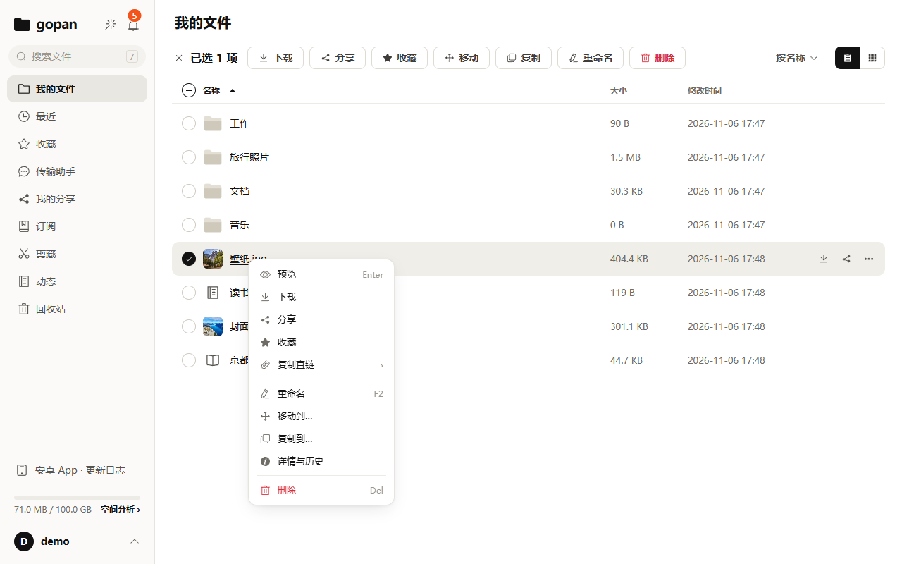

# Running a full cloud drive on a 2 GB VPS: keep file bytes out of the backend

> Draft for r/selfhosted and Show HN. Numbers cite the repo docs (Chinese). Before posting: resolve `TODO(confirm)` items, replace screenshot placeholders, make sure the README has an English version and the image can be pulled.

I wanted my own cloud drive: large uploads, previews, sharing, web plus phone, on a cheap 2 vCPU / 2 GB VPS that already hosts other services. Nextcloud-style suites do a lot, but they are too heavy for that box. So I wrote gopan.

This post is not a feature list. It covers the design choices that make it fit on a small machine, and two mistakes I made along the way.

## The stack

- **gopan**: one Go binary with the Vue 3 frontend embedded. GraphQL for metadata, plus WebDAV, a remote MCP endpoint and share pages.
- **Postgres**: metadata, transactions, the folder tree (recursive CTEs).
- **MinIO**: file bytes, over the S3 protocol.
- Optional **Gotenberg** for Office → PDF previews. Its LibreOffice sits at 300–500 MB, so it is off on my 2 GB box; everything except Office preview still works.

## File bytes never pass through the backend

Browsers, the Android app and AI agents ask gopan for a **presigned URL**, then talk to MinIO directly. gopan only signs URLs and verifies the result afterwards.

- Uploads go as 16 MB parts in parallel and resume after a dropped connection or a closed tab. Which parts are done is read from storage, not from the client's memory.
- Downloads, previews and video playback use presigned URLs too, with Range support.

So gopan's memory does not grow with traffic: a 10 GB upload never streams through the Go process.

The exceptions are explicit and each has a concurrency limit: streaming zip of folders, WebDAV (the protocol requires proxying), server-side "fetch this URL" downloads, archive browsing and extraction, public direct links (which need byte accounting), and image-host uploads.

## Content addressing

Objects are stored under their SHA-256: `blobs/{sha256}`.

- **Instant upload**: hash first; if the server already has those bytes, gopan just creates a node pointing at them.
- **Quota counts logical size**: two users storing the same file each pay for it, though it exists once on disk.
- **Deletion**: bytes are removed 24 hours after nothing references them anymore.

The trade-off: the server admin can tell whether a known file was ever stored. On a self-hosted box the admin is you, but know this before handing out accounts to people you don't trust.

## A memory snapshot

On 2026-11-06 I looked at `docker stats` on the production box, idle, without Gotenberg:

| container | usage | compose limit |
|---|---|---|
| gopan | 35 MiB | 384 MiB |
| postgres | 46 MiB | 384 MiB |
| minio | 103 MiB | 512 MiB |

Under 200 MiB for the three. That is one idle snapshot, not a peak. The docs record "about 350 MB resident" for the slim profile. TODO(confirm): why the two differ.

The design target is higher: 4 vCPU / 8 GB for 50 concurrent users, 20 GB single files, 2 TB total. 2 GB is the floor I have run it on.

## Deep folders: offset → keyset pagination

100,000 files in one folder, measured on a dev machine (Apple M4, Postgres 16 in a container), not on the VPS:

| page | offset | keyset |
|---|---|---|
| 1 | 13.3 ms | 14.7 ms |
| 250 | 26.1 ms | 11.8 ms |
| 500 (last) | 31.3 ms | 7.5 ms |

The shape matters more than the ratio: offset gets linearly slower because it scans and discards every earlier row; keyset seeks straight to the start on the index. It also stops pages from skipping or repeating rows while files are being added.

## Mistake 1: same-origin scripts

Presigned URLs were served from the site's own origin (`https://site/gopan/...` reverse-proxied to MinIO). Those responses bypass Go, so they carry no site CSP, and the content type comes from the uploader's file name — with deduplication, the *first* uploader's. Open an `.svg` or `.html` at top level and its script runs as the site, which is enough to trade the login cookie for an access token.

That needed a self-upload at first. Then I planned "file requests" (anonymous visitors uploading into your folder), and it became: a stranger drops an SVG, you click it, your account is gone. So it was fixed first, in two layers:

1. **Pin response headers when signing.** Images, audio/video and PDF keep their type; SVG keeps its type (so `` works) but gets `Content-Disposition: attachment`; everything else is served as `text/plain`. This lives in code, not in deployment config.
2. **The reverse proxy adds** `Content-Security-Policy: sandbox; default-src 'none'; ...` and `X-Content-Type-Options: nosniff` to `/gopan/` as a backstop.

If you serve user uploads from your own domain, check for this.

## Mistake 2 (avoided): building on the box

`docker compose up -d --build` on a 2 GB machine runs `pnpm install`, type checking, `vite build` and `go build`; the Node part alone takes 1–2 GB. The real risk is not a failed build but the OOM killer taking down the other services on the box. I cross-build amd64 images elsewhere and only run them on the server. TODO(confirm): switch this to "pull the prebuilt image" once one is published.

## Restores, not just backups

A backup that was never restored is not a backup. On 2026-09-18 I restored from the off-site copy and checked bytes and counts, not "it starts": `pg_restore` with zero errors; 24 blobs referenced, 24 objects in the archive, none missing or orphaned; 38 files compared byte-for-byte with the live volume; an isolated instance that logs in and downloads six files with matching SHA-256.

## Compared to others

| | gopan | Nextcloud | Seafile | Cloudreve |
|---|---|---|---|---|
| ships as | Go binary + Postgres + MinIO | PHP app + database | server + database | Go binary |
| bytes live in | object storage (S3), content-addressed | local or external storage | its own block format | local or various object stores |
| desktop sync client | no (WebDAV, Windows app, Android app instead) | yes | yes, its strength | TODO(confirm) |

TODO(confirm): re-check this table against current versions before posting.

Out of scope on purpose: collaborative editing, end-to-end encryption (the server must read content for dedup, previews and zips), video transcoding, an iOS app, multi-node clusters. If you need those, pick one of the others.

## How it was built

gopan is written by one person with AI coding assistants. Plans, trade-offs and post-mortems are in the repo's `doc/` folder (in Chinese).

Code: <https://github.com/yophon/gopan> (MIT). TODO(confirm): link the English README and say whether a public demo exists.
