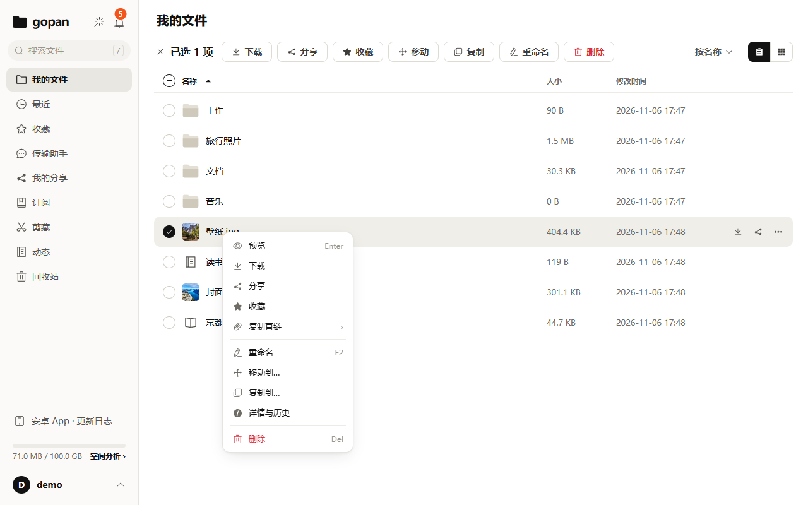

# 在 2G 内存的 VPS 上跑一个完整网盘：为什么文件字节不经过后端

> 草稿。数字都注明了出处（仓库里的 doc）；发布前核对标 `TODO(作者确认)` 的地方，替换截图占位符。

我想要一个自己的网盘：能传大文件、能预览、能分享、手机和电脑都能用，跑在一台 2 核 2G 的廉价 VPS 上，而且这台机器上还住着别的服务。Nextcloud 那类「自部署全家桶」功能很全，但对这台机器来说太重了。所以我写了 gopan。

这篇不讲功能清单，讲几个让它能在小机器上跑起来的取舍，以及踩过的两个坑。

## 一、组件：一个二进制，两个依赖

- **gopan**：一个 Go 二进制，前端（Vue 3）构建后 embed 进去。GraphQL 管元数据，另有 WebDAV、远程 MCP、分享页等 HTTP 路由。
- **Postgres**：元数据、事务、目录树（递归 CTE）。
- **MinIO**：文件本体，走 S3 协议。
- 可选的 **Gotenberg**：Office 转 PDF 预览。它里面的 LibreOffice 常驻 300～500MB，是全家桶里最大的内存开销，2G 机器上我把它关了。关掉之后 Office 文件不能在线预览，其他功能不受影响。（doc/10）

## 二、文件字节不经过后端

这是最重要的一个决定。

浏览器、安卓 App、Agent 上传和下载文件时，先向 gopan 要一个**预签名地址**，然后直接和 MinIO 收发字节。gopan 只做两件事：签发地址，事后核对。

- 上传按 16MB 分片并发直传。断线、关掉页面后能接着传，「已经传了哪些片」以存储里实际存在的分片为准，不以客户端的记忆为准。
- 下载、预览、视频播放同样拿预签名地址，支持 Range。

所以 gopan 进程的内存基本和流量无关：传一个 10GB 的文件，它也不用把 10GB 读一遍。

有些地方必须经过 Go，都是显式的例外，并且各自有并发上限：文件夹的流式 zip 打包、协议决定必须中转的 WebDAV、离线下载（服务器替你去源站拉）、压缩包的浏览与解压、要按流量记账的公开直链、图床上传和字幕转换。（README「架构」）

## 三、按内容寻址：同样的文件只存一份

文件在存储里的 key 是它的 SHA-256：`blobs/{sha256}`。

- **秒传**：上传前先算哈希，服务器上已经有同样内容的话，直接建一个节点指过去，不用再传字节。
- **配额按逻辑大小记**：两个人存了同一个文件，物理上只有一份，但各自的配额都算上它的大小。
- **删除**：没有任何人再引用某份内容时，物理文件在 24 小时宽限期后才真正清除。（doc/12）

代价也写在这里：去重意味着服务器管理员理论上能判断「某个已知文件是否有人存过」。自部署时管理员就是你自己，通常不是问题；但如果你要给不信任的人开账号，得知道这一点。（doc/12）

## 四、一次内存快照

2026-11-06 我在生产机上看了一眼 `docker stats`。当时没什么负载，没开 Gotenberg：

| 容器 | 占用 | compose 里给的上限 |
|---|---|---|
| gopan | 35 MiB | 384 MiB |
| postgres | 46 MiB | 384 MiB |
| minio | 103 MiB | 512 MiB |

三个加起来不到 200 MiB。这只是某天空闲时的一次快照，不代表上传、转码时的峰值。doc/12 里记的数字是「精简档常驻约 350MB」。TODO(作者确认)：两者的差距来自负载不同还是统计口径不同。

设计目标定得更高：单机 4 核 8G 支撑 50 个并发用户、单文件 20GB、总量 2TB；2 核 2G 是实测能稳定运行的下限。（doc/12）

## 五、深目录翻页：offset 换成 keyset

一个文件夹里放 10 万个文件，翻到最后一页会怎样？这是在开发机上测的，不是 VPS（Apple M4，Postgres 16 容器）：

| 页 | offset 分页 | keyset 分页 |
|---|---|---|
| 第 1 页 | 13.3ms | 14.7ms |
| 第 250 页 | 26.1ms | 11.8ms |
| 末页（第 500 页） | 31.3ms | 7.5ms |

重点不在倍数，在曲线的形状：offset 随页数线性变慢，因为要扫过并丢掉前面所有的行；keyset 从索引上直接定位起点，越往后反而越快。另一个好处是翻页过程中有人增删文件时，keyset 不会跳行，也不会出现重复。（doc/milestones/M8）

## 六、踩过的坑：同源的脚本

预签名地址为了省事和浏览器同源：`https://站点/gopan/...` 由反代转给 MinIO。问题就出在这里。

- 这些响应不经过 Go，也就没有站点的 CSP。
- 文件的类型来自上传者起的文件名。因为同样的内容只存一份，它取的是**第一个**上传者的文件名。
- 于是一个 `.svg` 或 `.html` 被顶层打开时，里面的脚本会以站点的身份运行。它可以带着登录 cookie 去换一个访问令牌，相当于接管账号。

一开始这需要自己上传才会踩到。等我准备加「收集链接」（让不登录的访客往你的文件夹里传文件）时，它就变成了：陌生人往你的网盘里塞一个 SVG，你点开，账号就没了。所以收集链接上线前先修了它，分两层：（doc/20 二.6）

1. **签地址时就把响应头定死。** 图片、音视频、PDF 保留原类型；SVG 保留类型（`` 要靠它渲染），但加上 `attachment`，顶层打开只会下载；其余一律按 `text/plain` 返回。这一层在代码里，不依赖部署配置。（`server/internal/objstore/minio.go` 的 `InlineOverrides`）
2. **反代给 `/gopan/` 的响应加头**：`Content-Security-Policy: sandbox; default-src 'none'; ...` 和 `X-Content-Type-Options: nosniff`。这一层兜底。

只要你在自己的域名下提供用户上传的文件，这个问题就值得查一遍。

## 七、备份要真的恢复过

备份没被恢复过，就等于没有备份。2026-09-18 我从异地副本做了一次恢复演练，判据都落在能核对的字节和计数上，而不是「服务起来了」：（doc/16）

- `pg_restore` 退出码 0，`ERROR` 0 行；
- 库里引用的 blob 24 个，备份里的对象 24 个，缺失 0，孤儿 0；
- 生产卷和备份逐文件比对，38 个文件（24 个 `xl.meta`、14 个 `part`）全部一致；
- 起一个隔离实例登录、列目录、下载 6 个文件，sha256 与原文件一致。

一个容易犯的错：MinIO 小对象内联存储、大对象分片存储，不能拿单个 part 的哈希去和对象名比，那样会得出「全部不匹配」的错误结论。

演练没有做成定时任务。它要起隔离实例，结果要人看；自动化之后只会得到「自动通过」的假信心。

## 八、小机器上不要构建

手册里标准的 `docker compose up -d --build`，在 2G 的机器上会跑 `pnpm install`、`vue-tsc`、`vite build` 和 `go build`，光 node 构建就能吃掉 1～2GB。真正的风险不是构建失败，而是触发 OOM killer，把同一台机器上已经在跑的服务一起杀掉。（doc/10）

所以我在开发机上交叉构建 amd64 镜像，传到服务器上只做启动。TODO(作者确认)：如果届时已经有公开的预构建镜像，这里改成「直接拉镜像」。

## 九、和别的方案比

| | gopan | Nextcloud | Seafile | Cloudreve |
|---|---|---|---|---|
| 交付 | Go 单二进制 + Postgres + MinIO | PHP 应用 + 数据库 | 服务端 + 数据库 | Go 单二进制 |
| 文件存在哪 | 对象存储（S3 协议），按内容寻址 | 本地或外部存储 | 自己的分块存储格式 | 本机或多种对象存储 |
| 桌面同步客户端 | 没有（有 WebDAV、Windows 桌面端、安卓 App） | 有 | 有，同步是它的强项 | TODO(作者确认) |
| 功能面 | 存储、预览、分享、WebDAV、Agent 工具 | 日历、办公等大量应用 | 以文件同步与共享为主 | 文件管理、分享、WebDAV、离线下载 |

TODO(作者确认)：发布前对照 Nextcloud、Seafile、Cloudreve 的当前版本核对这张表。

gopan 明确不做的：多人协同编辑、端到端加密（服务器要能看到内容，秒传、预览、打包才成立）、视频转码、iOS App、多机集群。（doc/12）如果你需要这些，选上面的其他方案更合适。

## 十、怎么写出来的

gopan 是我一个人借助 AI 编码助手写的。每个功能的计划、取舍、里程碑记录和踩坑都放在仓库的 `doc/` 里，可以对照代码看。

## 链接

- 代码：<https://github.com/yophon/gopan>（MIT）
- 架构与取舍：doc/02、doc/03；部署：doc/09；本文提到的坑：doc/10、doc/16、doc/20
- TODO(作者确认)：在线实例要不要放、开不开放注册
