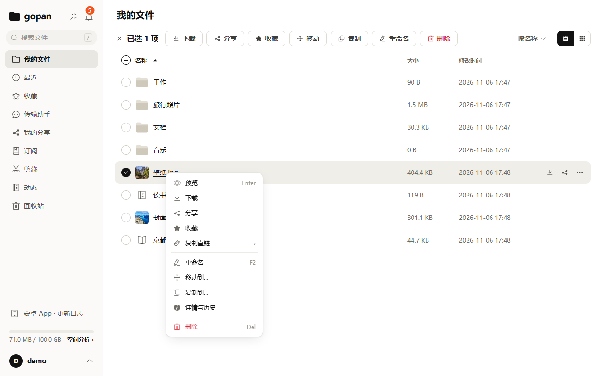

# 目录条目与社区帖子

> 草稿。提交前确认：README 已更新、镜像能直接拉、docs/MCP.md「客户端接入」已写好。各平台的字段和格式以提交时的页面为准。

## awesome-mcp-servers（punkpeye/awesome-mcp-servers）

提交前先看它 README 当前的分类、图例和格式要求（条目按字母序、图例表示语言与运行位置，规则可能变）。建议放在文件系统或云存储相关的分类下，以当时的分类为准。

```markdown
- [yophon/gopan](https://github.com/yophon/gopan) 🏎️ ☁️ - Self-hosted cloud drive with a built-in remote MCP server (Streamable HTTP, OAuth 2.1 or API key). Search, read and organize files, read PDF/Office text without downloading, create shares, file requests, URL downloads and web clips. File bytes go through presigned URLs, never through MCP; every agent change is logged and can be undone.
```

TODO(作者确认)：图例里 ☁️（云服务）和 🏠（本地服务）哪个更贴切——gopan 是自部署在自己服务器上的远程端点。

PR 标题：`Add gopan (self-hosted cloud drive with remote MCP)`

## mcp.so

| 字段 | 内容 |
|---|---|
| 名称 | gopan |
| 一句话 | 自部署网盘，自带远程 MCP：让 Agent 找、读、整理、分享你自己服务器上的文件 |
| 类型 | 远程（Streamable HTTP），自部署；没有 stdio 版本 |
| 端点 | `https://你的域名/mcp` |
| 认证 | OAuth 2.1（动态注册 + PKCE），或 API Key |
| 仓库 | https://github.com/yophon/gopan |
| 标签 | 文件、网盘、自部署、存储 |

介绍：

> gopan 是一个自部署网盘：Go 单二进制 + Postgres + MinIO，2 核 2G 的 VPS 能跑。它自带远程 MCP 端点，不用本地安装。
>
> 能做的：列目录、按名字和按文件内容搜索（PDF、Office 也能搜）、不下载就读 PDF / Office 的文字、建目录、移动、复制、改名、批量操作（可先预览）、放进回收站与恢复、建分享和收集链接、公开直链、离线下载、网页剪藏、浏览和解压压缩包、查动态与操作记录。
>
> 文件字节不经过 MCP：上传、下载走预签名地址，由 Agent 自己的 HTTP 工具完成。只能调 MCP、不能读本地文件的客户端（比如网页聊天）可以找、读、整理、分享，不能上传本地文件。
>
> 权限按组授权，可以把凭据限定在某个目录；删除只进回收站；每次调用有记录；Agent 做的改动在网盘「动态」里能按来源一键撤回。

## 魔搭 MCP 广场

TODO(作者确认)：平台是否收录自部署的远程服务、要不要填一个可公开访问的地址。不开放可写的公开演示实例（直链、图床、收集链接会被滥用），没有公开地址时只提交介绍和部署方式。

| 字段 | 内容 |
|---|---|
| 名称 | gopan 自部署网盘 |
| 简介 | 自部署网盘自带的远程 MCP：找、读、整理、分享自己服务器上的文件 |
| 部署方式 | 自部署后使用 `https://你的域名/mcp`；部署见仓库 doc/09 |
| 认证 | OAuth 2.1 或 API Key |
| 分类 | 文件管理 / 存储 |
| 许可证 | MIT |

详细介绍同上面 mcp.so 的介绍。

## V2EX「分享创造」

标题：

> gopan：一个能在 2G 内存 VPS 上跑的自部署网盘，自带远程 MCP

正文：

> 想要一个自己的网盘，机器是 2 核 2G 的 VPS，上面还跑着别的服务，Nextcloud 装不下，于是自己写了一个。
>
> - Go 单二进制 + Postgres + MinIO。上传下载走预签名地址，文件字节不经过后端，进程内存和流量无关。
> - 分片直传、断点续传、按内容秒传；图片、视频、PDF 预览（Office 预览是可选组件）；分享、收集链接、WebDAV。
> - 有安卓原生 App 和 Windows 桌面端。
> - 自带远程 MCP：Claude、Codex 这类 Agent 接上就能帮你找文件、读合同、归档发票、建分享。权限按组给，删除只进回收站，Agent 做的改动能一键撤回。
>
> 不做的：多人协同编辑、端到端加密、iOS App、集群。
>
> 代码（MIT）：https://github.com/yophon/gopan
> 架构取舍和踩坑写了一篇：TODO(第 02 篇的链接)
>
> 一个人借助 AI 编码助手写的，设计文档都在 `doc/` 里。欢迎提 issue，尤其是部署时卡住的地方。



## linux.do

标题：

> 给自建网盘接上了 MCP：让 Claude / Codex 直接整理你服务器上的文件

正文：

> 我的网盘 gopan 自带一个远程 MCP 端点。OAuth 2.1，填地址授权一次就能用，也可以用 API Key。
>
> 接上以后能做的事，比如：「把上个月的发票挑出来放进 /报销」（按文件内容搜，先预览再移动）、「这份合同的押金条款怎么写的」（不下载，直接读提取好的文字）、「给 /旅行 开个收集链接让朋友传照片」、「把这个链接下到 /软件」（服务器在后台下）、「把这篇文章剪藏一份」。
>
> 几个设计上的考虑：
>
> - 文件字节不经过 MCP，上传下载走预签名地址。所以网页聊天客户端能找、读、整理，不能传本地文件；Claude Code、Codex 能。
> - 权限按组给，可以限定目录；没有彻底删除；每次调用有记录；改动在「动态」里能按来源一键撤回。
>
> 网盘本身：Go 单二进制 + Postgres + MinIO，2 核 2G 的 VPS 能跑，有安卓 App 和 Windows 桌面端。
>
> 仓库（MIT）：https://github.com/yophon/gopan
> 实操：TODO(第 01 篇的链接)
>
> 一个人借助 AI 写的，欢迎拍砖。
